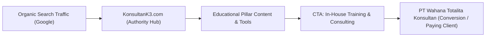

# Content & SEO Growth Strategy
**Brand:** `KonsultanK3.com`  
**Parent / Partner Brand:** `PT Wahana Totalita Konsultan` (`wahanatotalita.com`)  
**Objective:** Leverage 15-year domain age and educational citations to dominate Indonesian K3 search queries and funnel corporate leads to Wahana Totalita.

---

## 1. Positioning & Business Model

Instead of a generic blog, `KonsultanK3.com` will operate as an **Authoritative Industry Portal & Lead Magnet**:



* **Tagline:** *Portal Edukasi, Konsultasi & Sertifikasi K3 Indonesia*
* **Trust Endorsement:** *"Didukung secara resmi oleh PT Wahana Totalita Konsultan (PJK3 Resmi Kemnaker RI)"*

---

## 2. The 4 Content Pillars

### Pillar 1: Sertifikasi & Pembinaan K3 Kemnaker (High Commercial Intent)
Target high-ticket corporate training enrollments:
1. **Ahli K3 Umum Kemnaker RI:** Syarat, Jadwal, Silabus, dan Biaya Pembinaan.
2. **K3 Kebakaran (Kelas D, C, B, A):** Penanggulangan Kebakaran di Industri.
3. **K3 Listrik & Teknisi K3 Listrik:** Regulasi Permenaker No. 12/2015.
4. **Petugas & Ahli K3 Kimia:** Penanganan Bahan Berbahaya dan Beracun (B3).
5. **Operator Pesawat Uap & Bejana Tekan (Boiler / Forklift / Crane).**

### Pillar 2: Konsultasi Sistem Manajemen (B2B High Ticket)
Target corporate HSE managers seeking compliance:
1. **Penerapan & Sertifikasi SMK3 (PP No. 50 Tahun 2012):** Panduan 64, 122, dan 166 Kriteria Audit.
2. **Integrasi ISO 45001:2018:** Sistem Manajemen Keselamatan dan Kesehatan Kerja Internasional.
3. **Penyusunan Dokumen Lingkungan (AMDAL, UKL-UPL, SPPL).**
4. **Audit Internal & Gap Analysis K3.**

### Pillar 3: Edukasi & Pengetahuan K3 (Top-of-Funnel / Backlink Magnets)
Target university students, fresh graduates, and safety officers (reclaiming academic links):
1. **Program Pengendalian Kebisingan di Tempat Kerja (Direct Backlink Reclamation).**
2. **Standar & Klasifikasi Alat Pelindung Diri (APD) K3.**
3. **Mengenal Penyakit Akibat Kerja (PAK) & Pencegahannya.**
4. **Metode HIRARC / JSA (Job Safety Analysis):** Langkah Praktis Identifikasi Bahaya.
5. **Tugas & Pembentukan Panitia Pembina K3 (P2K3) di Perusahaan.**

### Pillar 4: Download Center & SOP Templates (Lead Generation)
Gated downloads requiring email / WhatsApp number:
1. Template Form Inspeksi K3 Harian & Mingguan.
2. Contoh Safety Induction Booklet untuk Tamu & Kontraktor.
3. Format Matriks HIRARC (Excel).
4. Checklist Audit SMK3 166 Kriteria (PDF/Excel).

---

## 3. Lead Funnel Architecture to Wahana Totalita

Every page on `KonsultanK3.com` must have a structured conversion pathway:

1. **Top Bar Sticky Notice:**  
   *"Butuh Sertifikasi K3 Kemnaker Resmi? Konsultasikan bersama PT Wahana Totalita Konsultan [Hubungi Konsultan Kami]"*
2. **In-Article Contextual CTAs:**  
   Placed after the second H2 heading:
   > 📌 **Butuh Pelatihan In-House atau Sertifikasi Resmi untuk Perusahaan Anda?**  
   > PT Wahana Totalita Konsultan melayani pembinaan K3 bersertifikat Kemnaker RI dengan instruktur ahli berpengalaman. [👉 Dapatkan Penawaran / Jadwal Pelatihan]
3. **Sticky WhatsApp Floating Button:**  
   Direct link pre-filled with:  
   `"Halo PT Wahana Totalita, saya membaca artikel di KonsultanK3.com dan ingin konsultasi mengenai [Topik/Pelatihan]..."`

---

## 4. Technical SEO & Schema Specifications

To maximize search visibility and rich snippets:

### 1. Structured Data Markup (JSON-LD)
* **Organization Schema:** Include `legalName`: "PT Wahana Totalita Konsultan" and `brand`: "Konsultan K3".
* **Course Schema:** Implement on training landing pages (Ahli K3 Umum, K3 Kebakaran) to enable Google Course Rich Results.
* **FAQPage Schema:** Place on core guide articles to win accordion FAQ serp snippets.

```json
{
  "@context": "https://schema.org",
  "@type": "Course",
  "name": "Pembinaan dan Sertifikasi Ahli K3 Umum Kemnaker RI",
  "description": "Program sertifikasi resmi Calon Ahli K3 Umum Kemnaker RI diselenggarakan oleh PT Wahana Totalita Konsultan.",
  "provider": {
    "@type": "Organization",
    "name": "PT Wahana Totalita Konsultan",
    "sameAs": "https://wahanatotalita.com"
  }
}
```

### 2. URL Permalinks Best Practice
* Clean, flat structure: `konsultank3.com/%postname%/`
* Avoid date-based URLs (`/2026/10/...`) and avoid numerical extensions (`-1461.html`).

### 3. Core Web Vitals Targets
* **LCP (Largest Contentful Paint):** $< 2.0\text{s}$ (lightweight theme, compressed WebP images).
* **INP (Interaction to Next Paint):** $< 150\text{ms}$ (minimal heavy JavaScript).
* **CLS (Cumulative Layout Shift):** $< 0.05$.
