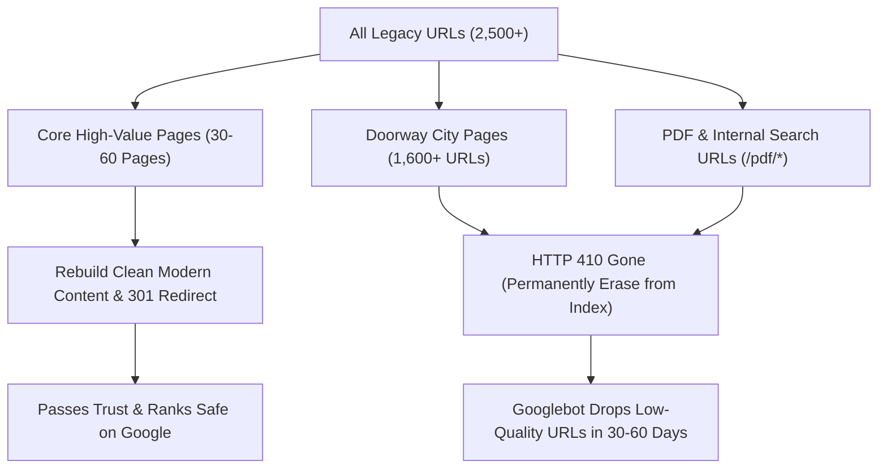

# Recovery & Purge Strategy Plan
**Target Domain:** `konsultank3.com`  
**Execution Context:** Site Relaunch as a stand-alone K3 information portal  

---

## 1. The Strategy: Selective Recovery vs. Aggressive Purging

When acquiring an aged domain with previous programmatic scaling:
* **DO NOT** attempt a 100% full recovery.
* **DO NOT** use a catch-all 301 redirect to any other domain.
* **DO** apply the **80/20 Rule**: Recover the authoritative top 20% of content that generated 80% of real trust, while permanently discarding programmatic doorway pages.

---

## 2. Inventory: What to Recover vs. What to Purge



### A. The RECOVER List (Priority 1)
1. **Root Domain (`/`):** Fresh homepage showcasing K3 consulting & training services.
2. **Pillar Informational Articles:**
   * `/program-pengendalian-kebisingan-331.html` $\rightarrow$ 301 to `/program-pengendalian-kebisingan/`
   * `/alat-pelindung-diri/` (APD standards)
   * `/penyakit-akibat-kerja/` (Occupational diseases)
   * `/syarat-ahli-k3-umum/` (Ahli K3 General certification requirements)
   * `/dasar-hukum-k3-indonesia/` (UU 1/1970, PP 50/2012 breakdown)
   * `/identifikasi-bahaya-penilaian-risiko-hirarc/`
   * `/tugas-dan-fungsi-p2k3/`
   * `/manajemen-k3-kebakaran/`
3. **Core Transactional / Lead Pages:**
   * Services / Layanan Konsultasi K3 (Audits, SMK3, ISO)
   * Training & Pembinaan K3 (Kemnaker & BNSP certified)
   * Kontak & Hubungi Kami (Direct inquiries via the site's own WhatsApp and contact form)

### B. The PURGE List (HTTP 410 Gone)
1. **All Programmatic City Permutations (1,600+ URLs):**
   * Pattern: `*-[0-9]{3,4}.html` (e.g. `training-pelatihan-dan-sertifikasi-*-di-*.html`)
2. **All Scraped PDF & Search Keyword Pages:**
   * Pattern: `/pdf/*`
   * Pattern: `/training/*` (legacy thin autogen subpaths)
3. **Old Pagination & Tag Clutter:**
   * Pattern: `/page/*` (let Google drop old historical pagination)
   * Pattern: `/tag/*`

---

## 3. Server-Level Implementation Rules

To execute this clean-up without losing server performance, configure server response codes immediately upon launching.

### Method 1: Cloudflare URL Rewrite / Transform Rules (Recommended)
Set up a Transform Rule:
* **Rule:** If URI Path matches regex `^/(pdf/|.*-[0-9]{3,4}\.html)` $\rightarrow$ Return Status **`410 Gone`**.

---

### Method 2: Nginx Configuration (`nginx.conf`)
```nginx
# 1. Permanent 410 Gone for Old Programmatic Doorway Pages and PDF scrapers
location ~* (-[0-9]{3,4}\.html|^/pdf/) {
    add_header Cache-Control "public, max-age=604800";
    return 410;
}

# 2. 301 Redirect for High-Value Legacy Inbound Links
location = /program-pengendalian-kebisingan-331.html {
    return 301 /program-pengendalian-kebisingan/;
}

# 3. Handle WordPress / Clean Site Rules
location / {
    try_files $uri $uri/ /index.php?$args;
}
```

---

### Method 3: Apache / LiteSpeed Configuration (`.htaccess`)
```apache
<IfModule mod_rewrite.c>
RewriteEngine On
RewriteBase /

# 1. 301 Redirects for High-Value Legacy URLs
RewriteRule ^program-pengendalian-kebisingan-331\.html$ /program-pengendalian-kebisingan/ [R=301,L]

# 2. Serve 410 Gone for old doorway patterns and /pdf/ scrapers
RewriteRule ^pdf/ - [G,L]
RewriteRule -[0-9]{3,4}\.html$ - [G,L]
RewriteRule ^training/.*\.html$ - [G,L]

# 3. Standard WordPress Front Controller
RewriteRule ^index\.php$ - [L]
RewriteCond %{REQUEST_FILENAME} !-f
RewriteCond %{REQUEST_FILENAME} !-d
RewriteRule . /index.php [L]
</IfModule>
```

---

## 4. Expected Timeline for Google Cleanup

* **Day 1 – 7:** Googlebot crawls legacy URLs and receives `410 Gone` headers.
* **Day 14 – 30:** Google Search Console flags 410 URLs as permanently removed and begins dropping them from the search index.
* **Day 30 – 60:** The site's index bloat reduces from ~2,500 down to the clean 30–60 core pages.
* **Day 60+:** Crawl budget concentrates 100% on new high-quality articles, driving rankings and authority up.
